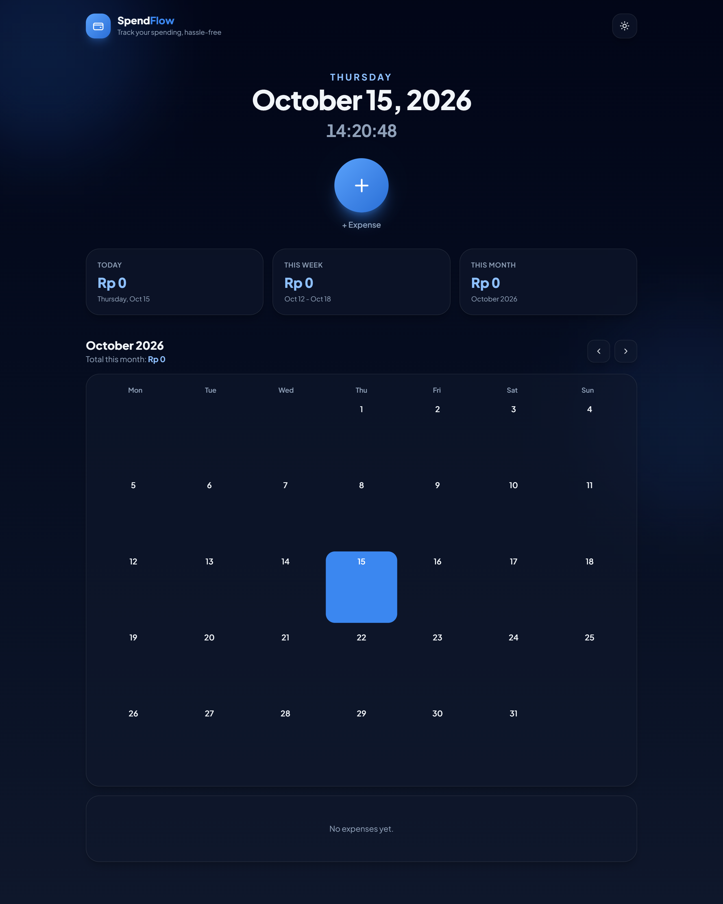
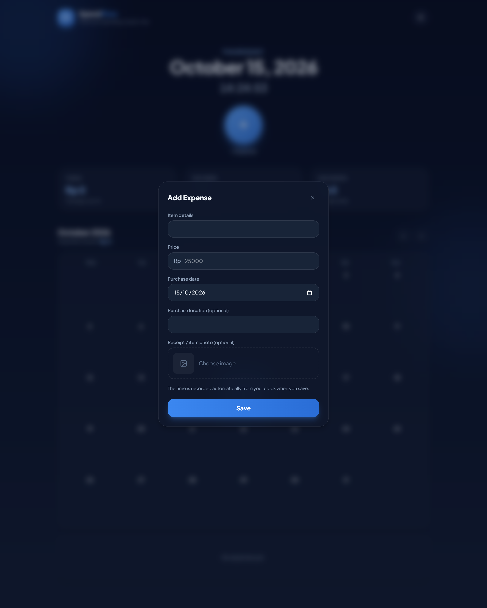
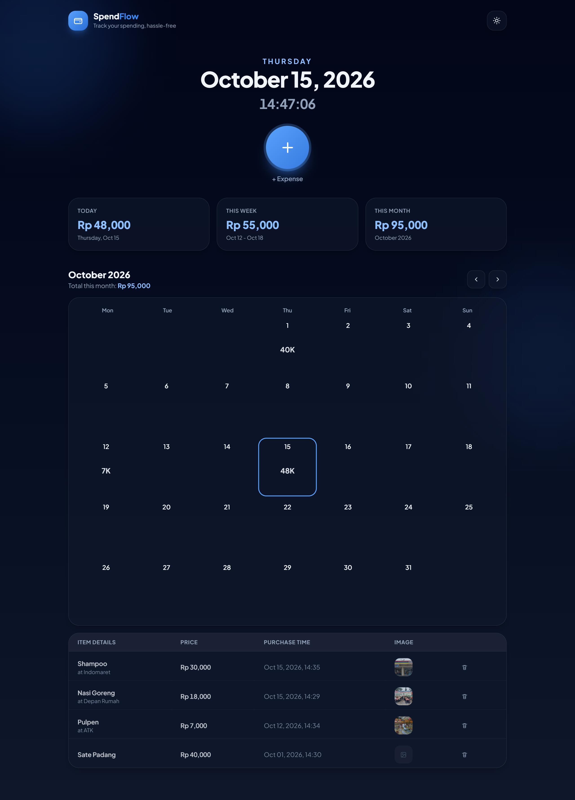
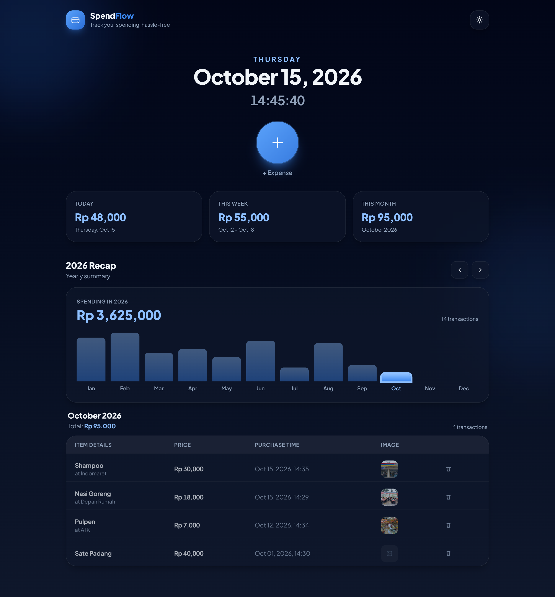

# SpendFlow 💳

> **Track your spending, hassle-free.**

**SpendFlow** is a modern, sleek, and intuitive web-based expense tracker designed to help users log, monitor, and manage their personal expenses efficiently. Built with a responsive dark-themed UI, SpendFlow provides time-based spending metrics, an interactive calendar view, and a dynamic yearly breakdown chart to give users complete control over their financial history.

---

## 📷 Preview

### Landing Page

### Add Expense

### Dashboard with Data

### Yearly Recap

---

## ✨ Key Features

### 🕒 Real-Time Header & Hero Section

- **Live Clock & Date**: Real-time clock display with local date tracking.
- **Quick Add Button**: Floating `+ Expense` modal trigger for quick transaction entry.
- **Theme Preference**: Toggle between Dark and Light mode (preference saved in `localStorage`).

### 📊 Time-Based Financial Metrics

- **Dynamic Cards**: Real-time spending summaries categorized into **Today**, **This Week**, and **This Month**.
- **Animated Numbers**: Smooth counting animations whenever financial values update.

### 🗓️ Interactive Calendar & History

- **Daily Total Badges**: Displays exact expenditure totals directly on each calendar date cell.
- **Month Navigation**: Cycle seamlessly between past and upcoming months.
- **Itemized Expense Table**: Detailed transaction logs complete with item names, prices in IDR, purchase location tags, receipt thumbnails, and automated timestamps.
- **Transaction Management**: Delete individual entries with a single click.

### 📈 Yearly Summary & Analytics

- **Yearly Recap Chart**: Interactive bar chart showcasing total monthly spending for the selected year.
- **Interactive Bars**: Click on any month's bar to jump directly into that month's detailed transaction view.

### 📝 Flexible Expense Input

- **Custom Purchase Date**: Choose custom purchase dates manually or default to today's date.
- **Optional Details**: Add optional location notes and upload receipt/item images.
- **Auto Timestamp**: Captures the exact clock time when an entry is submitted.

---

## 🛠️ Tech Stack

- **Build Tool:** Vite
- **Frontend Framework:** React.js (JSX)
- **Styling:** Tailwind CSS (via `@tailwindcss/vite`)
- **State Management:** Custom React Hooks (`useTheme`, `useCountUp`)
- **Icons:** Inline Custom SVG Components
